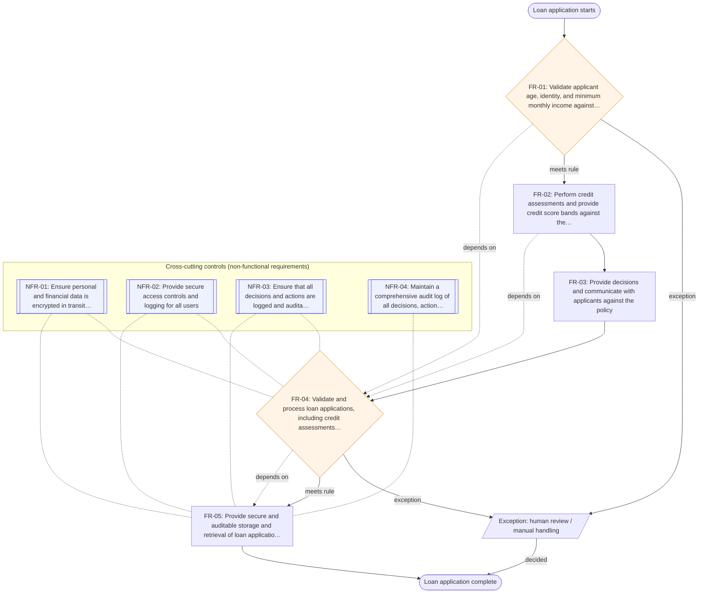

# Loan – process workflow

> Generated from human-approved requirements.

Every box is a requirement (its ID is in the label); diamonds are decisions with an exception path to human handling; boxes in *Cross-cutting controls* are non-functional requirements linked to the steps they protect.

| Requirement | Node | Text |
|---|---|---|
| FR-01 | decision | Validate applicant age, identity, and minimum monthly income against… |
| FR-02 | step | Perform credit assessments and provide credit score bands against the… |
| FR-03 | step | Provide decisions and communicate with applicants against the policy |
| FR-04 | decision | Validate and process loan applications, including credit assessments… |
| FR-05 | step | Provide secure and auditable storage and retrieval of loan applicatio… |
| NFR-01 | control | Ensure personal and financial data is encrypted in transit… |
| NFR-02 | control | Provide secure access controls and logging for all users |
| NFR-03 | control | Ensure that all decisions and actions are logged and audita… |
| NFR-04 | control | Maintain a comprehensive audit log of all decisions, action… |
